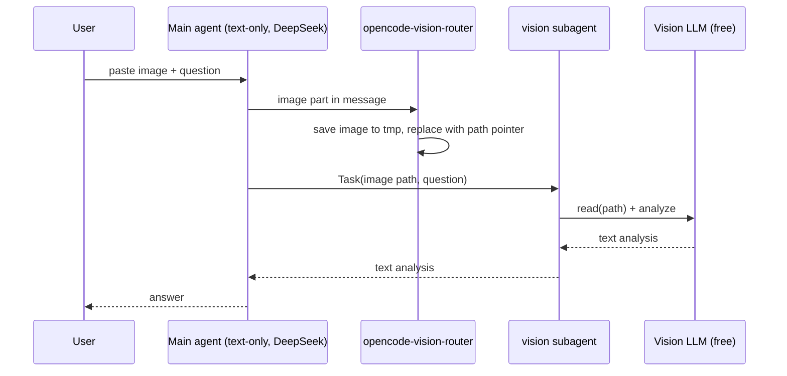

# OpenCode + DeepSeek Vision

> Give a text-only OpenCode setup the ability to **see images** — without changing your main model.

OpenCode + DeepSeek (e.g. `deepseek-v4-flash`) is fast and cheap, but the model is **text-only**:
it cannot accept image attachments. Pasting a screenshot makes OpenCode either drop it or fail.

This repository documents a small, production-tested recipe that fixes that at the **harness level**,
using the [`opencode-vision-router`](https://github.com/Chathula/opencode-vision-router) plugin:

- the image is intercepted before it reaches the main model,
- saved to a content-hashed file in the system temp directory,
- replaced in the message with a short text pointer,
- and handed to a dedicated **`vision` subagent** that reads the image and returns a textual
  description the main model can work from.

Your main model stays text-only, fast and inexpensive. Only the cheap vision subagent "sees" the bytes.

## Architecture



## Requirements

- [OpenCode](https://opencode.ai) v2 (tested on v2.2.7; v1 is also supported by the plugin).
- Network access on first run (the plugin is fetched from npm and cached in `~/.cache/opencode/npm/`).
- A vision-capable model. This recipe uses the free, built-in
  `opencode/nemotron-3.5-super-vl-free` (no API key required).

## Quick start

### 1. Add the plugin to your OpenCode config

Edit `~/.config/opencode/opencode.json` and add (or extend) the `plugins` array:

```json
{
  "model": "b-ai/deepseek-v4-flash",
  "plugins": [
    {
      "package": "opencode-vision-router",
      "options": {
        "model": "opencode/nemotron-3.5-super-vl-free",
        "force": true
      }
    }
  ]
}
```

See [`examples/opencode.json`](./examples/opencode.json) for a minimal, sanitized example.

### 2. Restart OpenCode

Plugins are **not** hot-reloaded. Quit and reopen `opencode`.

### 3. Verify

Paste an image into the chat and ask, e.g. *"What is in this image?"*.

You should see the `vision` subagent spawn (Task/subagent in the UI), read the image, and return
a textual description; the main model then answers your question.

Decoded images are cached under the system temp directory (e.g. `/tmp/opencode-vision/` on
macOS/Linux) with a SHA-1 hash in the filename and reused across calls.

## Configuration options

| Option   | Required | Default       | Description |
| -------- | -------- | ------------- | ----------- |
| `model`  | yes      | —             | Vision-capable model as `provider/model`. |
| `agent`  | no       | `vision`      | Name of the injected vision subagent. |
| `tmpDir` | no       | `os.tmpdir()` | Directory where decoded images are cached. |
| `force`  | no       | `false`       | Route images even when the main model is multimodal (use a cheaper vision model). |

## How it works

1. **Subagent injection** — the plugin declares the chosen model as image-capable and injects the
   `vision` subagent (`agent.transform` in v2 / `config` hook in v1).
2. **Capability detection** — per model, it learns whether the main model can see images; if it can
   and `force` is not set, routing is skipped.
3. **Image rewrite** — the image part is stripped from the user message and replaced with a text
   pointer containing the resolved path, so a text-only model never sees the bytes.
4. **Tool-result safety** — images embedded in tool results (e.g. `read` of an image file) are
   stripped the same way, so they are not replayed to a text-only model on later steps.
5. **Permissions** — the `vision` subagent may only read the image; `bash`, `edit`, `webfetch` and
   `doom_loop` are denied.

## Troubleshooting

- **No reaction to an image / no subagent spawns**
  - Confirm the entry is in `~/.config/opencode/opencode.json` (not `opencode.jsonc`).
  - Restart OpenCode.
  - Check the console: the plugin logs a warning if `model` is missing.
- **Plugin fails to download (offline)** — copy the cached directory
  `~/.cache/opencode/npm/opencode-vision-router@latest` from a working machine.
- **Vision model unavailable** — switch `model` to another image-capable model (e.g.
  `opencode-go/qwen3.7-plus`, `anthropic/claude-3-5-haiku`, `openai/gpt-4o-mini`) and configure
  the corresponding provider with an API key in the `provider` section.
- **Multimodal main model skips routing** — set `force: true`.

## Credits

- Plugin: [Chathula/opencode-vision-router](https://github.com/Chathula/opencode-vision-router)
  (npm: `opencode-vision-router@0.2.2`, MIT).
- OpenCode: [opencode.ai](https://opencode.ai).

## License

[MIT](./LICENSE) © Milosz Zajac
